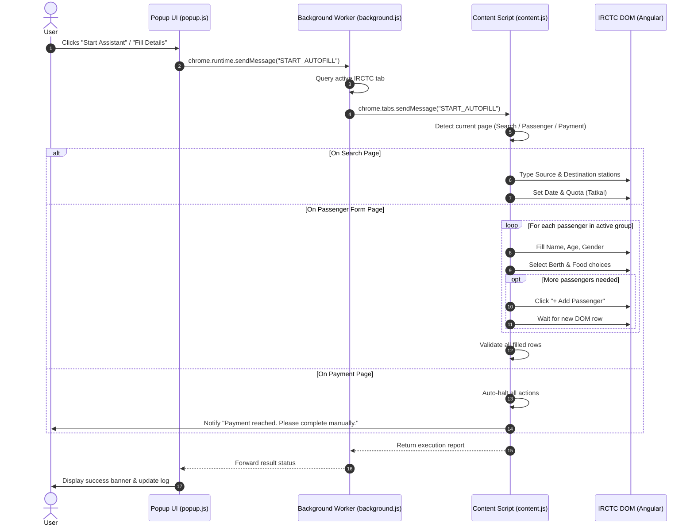
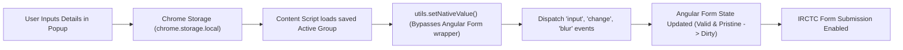

# System Architecture

## 1. Architectural Overview

The **IRCTC Tatkal Booking Assistant** is structured according to the Chrome Extension Manifest V3 standard, decoupling concerns between presentation (Popup UI), coordination (Background Service Worker), and DOM automation (Content Script).

```mermaid
flowchart TD
    subgraph Browser ["Chrome Browser"]
        subgraph PopupUI ["Popup Interface (popup.html / js)"]
            Dashboard["Dashboard Tab"]
            Passengers["Passengers CRUD"]
            Groups["Groups Management"]
            Journey["Journey Config"]
            Assistant["Assistant Controls"]
        end

        subgraph Background ["Background Service Worker (background.js)"]
            Router["Message Dispatcher"]
            StateTracker["State & Tab Monitor"]
        end

        subgraph Storage ["Chrome Local Storage"]
            StoreP["Passengers Store"]
            StoreG["Groups Store"]
            StoreJ["Journey Store"]
            StoreL["Activity Logs"]
        end

        subgraph ActiveTab ["IRCTC Tab / Test Bench"]
            CS["Content Script (content.js)"]
            Utils["DOM Utilities (utils.js)"]
            Obs["MutationObserver Engine"]
            DOM["IRCTC Angular DOM"]
        end
    end

    PopupUI <-->|chrome.storage.local| Storage
    PopupUI -->|chrome.runtime.sendMessage| Background
    Background -->|chrome.tabs.sendMessage| CS
    CS <-->|chrome.storage.local| Storage
    CS --> Utils
    CS --> Obs
    Obs --> DOM
    Utils --> DOM
```

---

## 2. Component Communication & Lifecycle Sequence

---

## 3. Data Flow Pipeline

---

## 4. Security Boundaries & Ethical Constraints

| Boundary | Enforcement Mechanism |
| :--- | :--- |
| **No CAPTCHA Solving** | Extension stops execution at the review page and instructs the user to type CAPTCHA manually. |
| **No Payment Automation** | Immediate hard-stop triggered upon detecting `/payment` URLs or bank selection elements. |
| **No Credential Storage** | Never asks for or saves IRCTC passwords, bank account numbers, CVVs, or OTPs. |
| **Strictly Local Storage** | All profile and group data resides exclusively on the client machine via `chrome.storage.local`. Zero third-party transmissions. |
| **No Unauthorized Endpoints** | Interacts exclusively with standard visible DOM elements without hitting private or unauthenticated endpoints. |
